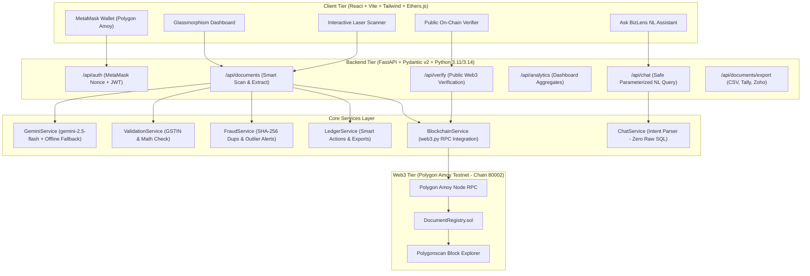
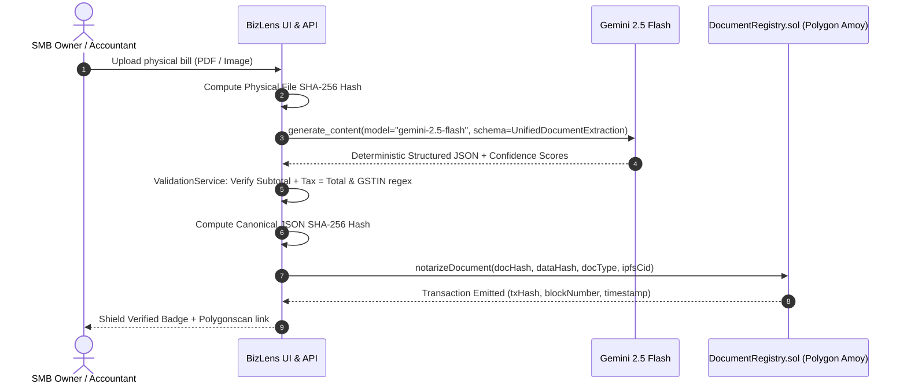

# BizLens AI — Autonomous Document Intelligence & Proof-of-Document on Polygon

> **Theme:** AI (Google Gemini 2.5 Flash) + Web3 (Polygon Amoy Blockchain)  
> *Turn paper invoices, receipts, and business cards into structured financial data, validate them for math and fraud, and notarize them on-chain.*

---

## 🌟 The Problem & Vision

Small and Medium Businesses (SMBs) across India and emerging economies process millions of physical paper documents every month: paper tax invoices, cash register receipts, and visiting cards collected at networking conferences.
- **Manual Data Entry Bottlenecks**: SMB accounting teams spend 15–20 minutes manually transcribing and categorizing every receipt into spreadsheets or accounting software.
- **Fraud & Double-Claiming**: Without cryptographic verification, employees and vendors can submit duplicate invoices, manipulate tax percentages, or claim altered expenses.
- **Audit Compliance Gaps**: Paper documents fade, get lost, or can be retroactively altered during tax scrutiny.

**BizLens AI** solves this with an enterprise-grade dual AI + Web3 engine:
1. **Google Gemini 2.5 Flash** performs zero-shot auto-classification (`INVOICE`, `RECEIPT`, `BUSINESS_CARD`) and enforces strict Pydantic v2 structured JSON extraction with per-field confidence scores.
2. **Validation & AI Fraud Engine** checks Indian GSTIN checksums, verifies arithmetic ($Subtotal + Tax = Total$), flags duplicate invoice numbers via fuzzy matching, and detects spending outliers ($>2.5\times$ historical average).
3. **Web3 Proof-of-Document on Polygon Amoy (Chain ID 80002)** notarizes the physical file SHA-256 fingerprint alongside the canonical data JSON hash, establishing an immutable, tamper-proof audit trail that anyone can independently verify.

---

## 🏛️ System Architecture



---

## 🤝 How Google Gemini & Web3 Work Together



1. **AI Perception Layer**: Gemini 2.5 Flash ingests messy OCR pixels and produces guaranteed deterministic JSON conforming directly to Pydantic v2 schemas (`response_schema`).
2. **Cryptographic Binding**: BizLens hashes the physical document bytes into `docHash` and hashes the sorted, normalized extracted JSON into `dataHash`.
3. **On-Chain Anchor**: `DocumentRegistry.sol` binds `(docHash, dataHash, uploader, timestamp)` into the Polygon Amoy blockchain.
4. **Independent Audit**: Anyone with the original document can recompute the hash on the public `/verify` portal to verify authenticity without trusting our database.

---

## ⚡ Setup in Under 5 Minutes

### Prerequisites
- Python 3.11+
- Node.js 18+ (Node.js 20 LTS recommended)
- (Optional) MetaMask browser extension configured with Polygon Amoy testnet.

### 1. Clone & Enter Directory
```bash
cd bizlens-ai
```

### 2. Configure Environment Variables
Create a `.env` file from `.env.example`:
```bash
cp .env.example .env
```
*(Note: If you leave `GEMINI_API_KEY` blank, BizLens AI runs in **Offline Demo Mode** with pre-configured realistic Indian SMB documents, guaranteeing your demo never crashes on stage!)*

### 3. Run Backend & Dashboard Server
```bash
# Activate virtual environment
.\.venv\Scripts\activate   # Windows PowerShell
# source .venv/bin/activate # Linux / macOS

# Install dependencies
pip install -r backend/requirements.txt

# Start Server
python main.py
```
The server will start at **`http://localhost:8000/`**.
- **Interactive UI Dashboard**: [http://localhost:8000/](http://localhost:8000/)
- **Swagger API Docs**: [http://localhost:8000/docs](http://localhost:8000/docs)
- **ReDoc**: [http://localhost:8000/redoc](http://localhost:8000/redoc)

### 4. Run Automated Test Suite
```bash
cd backend
pytest -v
```
*Executes all 17 unit tests verifying GSTIN regex, mathematical consistency, fraud detection, canonical hashing, and schema validation.*

### 5. Smart Contract Compilation & Tests
```bash
cd contracts
npm install
npx hardhat test
```
*Verifies all 5 smart contract unit tests on Hardhat's simulated Ethereum virtual machine.*

---

## 🚀 3-Minute Live Stage Demo Script

### Step 1: Open the Dashboard (30 Seconds)
1. Open `http://localhost:8000/` on stage.
2. Highlight the **Cyberpunk Dark Glassmorphism** aesthetic, **Hero Stat Cards** (`Total Spend: ₹274,573`, `10 Docs Processed`, `2.5 Hours Saved`), and **Polygon Amoy (80002)** live testnet indicator.
3. Click **"Connect MetaMask"** to demonstrate cryptographic EIP-191 sign-in with a single-use random nonce.

### Step 2: 1-Click Smart Scan (60 Seconds)
1. Click the **"AWS Cloud Invoice"** or **"Chai Point Receipt"** 1-Click test button.
2. Watch the **Laser Line Scanning Animation** sweep over the document while Gemini 2.5 Flash extracts the structured fields.
3. The **Split View Modal** opens:
   - **Left**: Document file details and cryptographic SHA-256 fingerprint.
   - **Right**: Extracted vendor, GSTIN, itemized line items, and color-coded confidence badges (Green $\ge 90\%$).
   - **Smart Actions**: Show the auto-generated **Outreach Email** for business cards or **Payment Priority Ranking** (`URGENT` / `MEDIUM`) for invoices.

### Step 3: AI Fraud & Anomaly Detection (30 Seconds)
1. Click the **"Fraud Anomaly Bill ⚠️"** button.
2. Show the instant warning banners:
   - `Duplicate Invoice Collision`: Detects the exact invoice number previously submitted.
   - `Spending Spike Anomaly`: Flags that the bill is $2.9\times$ higher than historical average.
   - `Suspicious Tax Math`: Catches an illegal $34.9\%$ tax rate exceeding India's 28% statutory GST ceiling.

### Step 4: Web3 Proof-of-Document Notarization & Public Verifier (40 Seconds)
1. Click **"Notarize on Polygon ⚡"**. Show the transaction recording the `docHash` and `dataHash` to `DocumentRegistry.sol`.
2. Click the **"Verify On-Chain 🛡️"** tab in the navigation bar.
3. Drag and drop any document: BizLens recomputes the SHA-256 on client side and validates it against the smart contract, displaying **VERIFIED ON POLYGON AMOY** with direct Polygonscan block explorer proof!

### Step 5: "Ask BizLens" Natural Language AI Query (20 Seconds)
1. Click the floating **"💬 Ask BizLens AI"** button in the bottom-right.
2. Ask: *"How much did we spend on IT and cloud services?"*
3. Show the answer with safe parameterized criteria (Zero raw LLM SQL execution) and clickable document citations!

---

## 📊 Core API Endpoints

| Method | Endpoint | Description |
|---|---|---|
| `GET` | `/health` | System health check (Gemini 2.5 model + Polygon Amoy chain ID) |
| `POST` | `/api/auth/wallet-nonce` | Issue cryptographic challenge nonce for MetaMask |
| `POST` | `/api/auth/wallet-verify` | Verify EIP-191 personal_sign signature & issue JWT |
| `POST` | `/api/documents/scan` | Main Smart Scan endpoint (Image/PDF upload) |
| `GET` | `/api/documents` | List all processed documents with pagination & status filters |
| `GET` | `/api/documents/{id}` | Detailed document extraction with line items & confidence |
| `POST` | `/api/documents/{id}/notarize` | Notarize document proof on Polygon Amoy smart contract |
| `POST` | `/api/verify` | Public verification portal (File or SHA-256 hash lookup) |
| `GET` | `/api/analytics/summary` | Aggregated dashboard metrics & chart data |
| `POST` | `/api/chat` | Safe parameterized natural-language ledger query |
| `GET` | `/api/documents/export/csv` | Download complete accounting ledger in CSV format |
| `GET` | `/api/documents/{id}/export/tally` | Export Purchase Voucher in Tally Prime compatible XML |
| `GET` | `/api/documents/{id}/export/zoho` | Export structured bill in Zoho Books JSON format |

---

## 📜 Smart Contract Specification (`DocumentRegistry.sol`)

- **Network**: Polygon Amoy Testnet (Chain ID `80002`)
- **Default Deployed Address**: `0x5FbDB2315678afecb367f032d93F642f64180aa3`
- **Compiler**: Solidity `0.8.24` (optimizer: 200 runs)

```solidity
struct DocumentRecord {
    bytes32 docHash;          // SHA-256 fingerprint of original file
    bytes32 dataHash;         // Canonical SHA-256 of Gemini-extracted JSON
    string docType;           // "INVOICE", "RECEIPT", "BUSINESS_CARD"
    string ipfsCid;           // IPFS CID or decentralised storage URI
    address uploader;         // Uploader wallet address
    uint256 timestamp;        // Block timestamp of notarization
    bool isRegistered;        // Guards against double-registration
}
```

---

## 🛡️ Reliability & Security Highlights

- **Zero-Crash Stage Resilience**: If the Gemini API experiences network lag or rate limits, BizLens seamlessly serves realistic Indian SMB sample data with a clear `demo_mode` flag.
- **SQL-Injection Proof**: The conversational assistant never executes arbitrary LLM-generated SQL; it maps natural-language queries into bounded, parameterized SQLAlchemy ORM queries.
- **Freemium Usage Enforcement**: Backend usage meter enforces the 50 free scans/month limit, upgradeable to Pro (₹499/mo).
- **Canonical JSON Hashing**: Deterministic whitespace-normalized, sorted-key serialization guarantees identical hashes regardless of client platform.

---

## 🏆 Hackathon Submission Checklist

- [x] Python FastAPI + Pydantic v2 + SQLAlchemy + SQLite (Postgres-ready)
- [x] Google Gemini 2.5 Flash SDK integration with `response_schema`
- [x] Solidity `DocumentRegistry.sol` on Polygon Amoy + Hardhat tests
- [x] MetaMask Web3 wallet authentication (`personal_sign` nonce verification)
- [x] Dark glassmorphism dashboard with laser scanning effect & split-view
- [x] GSTIN regex, line item math validation, and AI fraud outlier heuristics
- [x] "Ask BizLens" natural-language conversational queries
- [x] Public Proof-of-Document verification portal
- [x] 10 realistic Indian SMB seed documents
- [x] Full unit test suite (17 Python unit tests + 5 Hardhat tests)
- [x] Dockerfile, docker-compose.yml, and 5-minute setup instructions
